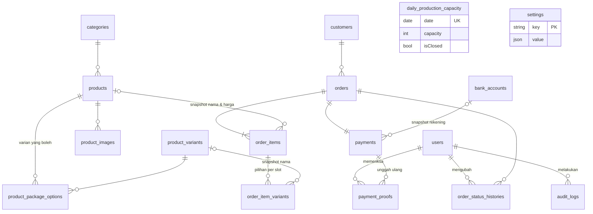
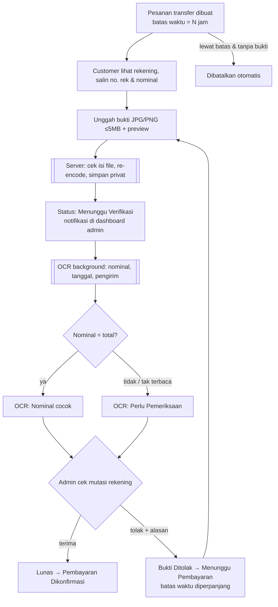

# Hakuu Bakery — System Planning (Tahap 1)

## 1. Analisis kebutuhan

| Aktor | Kebutuhan utama |
|---|---|
| **Customer** (tanpa akun) | Melihat katalog, mencari & memfilter, meracik Paket Hemat (pilih varian per slot), keranjang, checkout (pick up / delivery, jadwal), bayar cash / transfer, unggah bukti, lacak pesanan dengan nomor pesanan + WhatsApp, hubungi toko via WhatsApp |
| **Admin / Owner** (login) | Dashboard ringkasan, CRUD produk & paket dinamis, kategori, varian, rekening bank, kelola pesanan & status, verifikasi pembayaran (dibantu OCR), customer, laporan + export, pengaturan toko & kapasitas produksi |

Kebutuhan non-fungsional: responsif (mobile-first), harga divalidasi server, upload dibatasi tipe & ukuran, password di-hash, akses admin terpisah, data bisnis dapat dikonfigurasi (tidak di-hardcode), status pesanan tercatat (audit trail).

## 2. Pilihan teknologi & alasannya

| Lapisan | Pilihan | Alasan |
|---|---|---|
| Frontend + backend | **Next.js 15 App Router** | Satu codebase; Server Components untuk halaman cepat, Route Handlers untuk API customer, Server Actions untuk mutasi admin |
| Database | **PostgreSQL + Prisma** | Relasional, transaksi & advisory lock untuk kapasitas; skema bisa langsung dipakai di **Supabase** (Supabase = Postgres) |
| Auth | **Sesi JWT (jose) di cookie httpOnly + bcrypt** | Dipilih *alih-alih* Supabase Auth agar aplikasi dapat berjalan 100% lokal tanpa akun pihak ketiga. Hanya admin yang login; customer diverifikasi lewat nomor pesanan + WhatsApp (cookie bertanda tangan) |
| Storage | **Disk lokal (modul `lib/storage.ts`)** | Berjalan offline. Bukti transfer disimpan privat & disajikan lewat route yang memeriksa hak akses. Modul dapat diganti Supabase Storage/S3 tanpa mengubah pemanggil |
| UI | Tailwind CSS v4 + komponen sendiri bergaya shadcn | Identitas visual Hakuu (maroon #4D0C14, light brown #DBA179, brown #7E4722, krem) tanpa tampilan template generik |
| Chart | Recharts | Grafik dashboard & laporan |
| Export | ExcelJS, jsPDF + autotable, halaman cetak | Excel, PDF, dan print browser |
| OCR | Tesseract.js (data bahasa ind+eng dari npm) | Jalan di server tanpa layanan eksternal; hanya alat bantu |

Font: brand guideline memakai *Vonca Medium* (berlisensi). Website memakai **Marcellus** (judul, karakter flared serif yang mirip) dan **Plus Jakarta Sans** (teks), di-host sendiri via `@fontsource`. Logo pada website memakai file logo resmi yang diberikan.

## 3. Arsitektur

```mermaid
flowchart LR
  subgraph Browser
    C[Customer pages<br/>cart di localStorage<br/>(hanya id+qty+varian)]
    A[Admin dashboard]
  end
  subgraph Next.js server
    RH[Route Handlers /api/*<br/>quote, orders, proof, track, files]
    SA[Server Actions<br/>admin/actions.ts]
    SVC[lib: order-service · payment-service<br/>reports · settings · storage · ocr]
    MW[middleware: proteksi /admin]
  end
  DB[(PostgreSQL)]
  FS[(storage/<br/>products · site · proofs)]
  OCR[[Tesseract.js<br/>background after()]]
  WA[[wa.me Click-to-Chat]]
  C --> RH --> SVC
  A --> MW --> SA --> SVC
  SVC --> DB
  SVC --> FS
  RH -. setelah upload .-> OCR --> DB
  C -. link .-> WA
```

## 4. ERD



Catatan desain:
- **Snapshot**: `order_items` menyimpan nama, tipe, harga satuan, isi paket; `order_item_variants` menyimpan nama varian per slot; `payments` menyimpan rekening tujuan. Perubahan produk/rekening tidak mengubah histori.
- **Paket dinamis**: `products.packageSize` menentukan jumlah slot; `product_package_options` menentukan varian yang boleh (opsional `maxPerPackage`); `products.allowDuplicateVariants` mengatur varian berulang.
- **sales_records** tidak dibuat sebagai tabel: laporan dihitung langsung dari `orders`/`payments` (sumber kebenaran tunggal, menghindari data ganda). `audit_logs` ditambahkan untuk tindakan sensitif.
- Uang disimpan sebagai `Int` Rupiah. Produk dihapus secara *soft delete*.

## 5. Alur pemesanan

```mermaid
flowchart TD
  A[Pilih produk] --> B{Paket?}
  B -- ya --> C[Pilih varian untuk SETIAP slot<br/>jumlah slot = isi paket] --> D
  B -- tidak --> D[Tambah ke keranjang]
  D --> E[Keranjang: harga di-quote server]
  E --> F[Checkout: data diri, pick up/delivery,<br/>tanggal & waktu, catatan, metode bayar]
  F --> G[Validasi client]
  G --> H[[Server: validasi zod · hitung ulang harga ·<br/>cek varian · lock tanggal · cek kapasitas ·<br/>kurangi stok · buat pesanan + histori]]
  H -- gagal --> F
  H -- Cash --> I[Menunggu Konfirmasi]
  H -- Transfer --> J[Menunggu Pembayaran]
  I -- admin konfirmasi --> K[Masuk Jadwal Produksi]
  J --> P[[Alur pembayaran]] --> L[Pembayaran Dikonfirmasi] --> K
  K --> M[Sedang Diproduksi] --> N[Packing] --> O[Siap Diambil / Siap Diantar]
  O -- delivery --> Q[Dalam Pengiriman] --> R
  O -- pick up --> R[Selesai<br/>(wajib Lunas)]
  I & J & K & M & N & O & Q -. alasan wajib .-> X[Dibatalkan<br/>stok dikembalikan]
```

## 6. Alur pembayaran transfer



## 7. Aturan bisnis yang diterapkan
- Nomor pesanan unik `HKU-YYMMDD-XXXXX` (acak, tidak berurutan agar tidak bisa ditebak).
- Total = Σ(harga efektif × qty) + ongkir (flat, diatur admin) — selalu dihitung server.
- Kapasitas produksi dalam **pcs** (paket dihitung sebanyak isinya). Default per hari + override per tanggal + hari libur rutin. Dicek di dalam transaksi dengan `pg_advisory_xact_lock` per tanggal sehingga checkout bersamaan tidak melampaui kapasitas.
- Stok (opsional per produk) dikurangi atomik saat pesanan dibuat, dikembalikan saat batal.
- Pesanan hanya bisa **Selesai** bila pembayaran **Lunas** (cash dapat ditandai lunas saat menyelesaikan).
- Pesanan **Selesai tidak dapat dibatalkan/dihapus**. Pesanan batal dapat diarsipkan (soft delete) dengan alasan & tercatat di `audit_logs`.
- Pesanan batal setelah lunas → status pembayaran *Dikembalikan* (refund manual).
- **Laporan**: Omzet = pesanan Selesai & Lunas (tanggal selesai). Pembayaran diterima = pembayaran Lunas (tanggal lunas). Belum lunas = pesanan aktif belum lunas. Pesanan batal tidak dihitung.

## 8. Keamanan
- Password bcrypt (cost 12); sesi admin JWT HS256 di cookie httpOnly, SameSite=Lax, Secure di produksi; diverifikasi di middleware **dan** ulang ke database di setiap halaman/aksi (akun nonaktif langsung terkunci).
- Customer hanya dapat membuka pesanan yang diverifikasi (cookie bertanda tangan berisi nomor pesanan). Pesan error lacak dibuat generik.
- Rate limit: login, checkout, lacak, upload bukti.
- Upload divalidasi dari isi file (sharp), bukan ekstensi; di-re-encode (membuang EXIF/payload); ukuran ≤5 MB; nama file acak; bukti transfer tidak dapat diakses publik.
- Validasi zod di client & server; query via Prisma (parameterized); header keamanan (X-Frame-Options, nosniff, Referrer-Policy).
